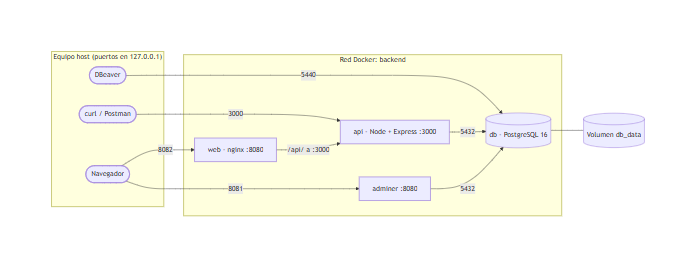

# Plataforma de tareas con Docker Compose

Tablero Kanban (Por hacer / En curso / Hecho) para que los empleados de una pyme carguen tareas, vean su estado y obtengan un reporte simple. Es un trabajo práctico de Entornos Virtualizados (UTN Santa Fe): el foco es la arquitectura con contenedores, la persistencia y la reproducibilidad del despliegue.

## Origen del proyecto

Parte de una lista de tareas que armé en 2022 con HTML, CSS y JavaScript, sin backend ni base de datos: https://jtendersentodolist.netlify.app/. Para este trabajo la retomé, la actualicé y la dockericé: agregué una API, PostgreSQL con persistencia, estados de tarea (tablero Kanban) y la orquestación con Docker Compose, para darle el contexto de una plataforma interna de una pyme.

## Arquitectura



El código fuente del diagrama está en [docs/arquitectura.mmd](docs/arquitectura.mmd).

| Servicio | Imagen | Función |
|---|---|---|
| `web` | `nginxinc/nginx-unprivileged` (build propio) | Sirve el frontend y reenvía `/api/` a la API |
| `api` | `node:22.22-alpine3.24` (build propio) | API REST de tareas |
| `db` | `postgres:16.16-alpine3.24` | Base de datos, datos en el volumen `db_data` |
| `adminer` | `adminer:6.3.0` | Administración web de la base |

Los servicios se comunican por nombre (`api`, `db`) dentro de la red `backend`. Todos los puertos se publican solo en `127.0.0.1`.

## Requisitos

- Docker con Compose v2 (`docker compose version`). Probado con Docker Desktop en Windows 11.
- Puertos libres en el host: 8082, 3000, 8081 y 5440 (se pueden cambiar en `.env`).
- Conexión a internet en el primer arranque, para descargar las imágenes.

## Despliegue

```bash
git clone https://github.com/Jtendersen/evi-plataforma-tareas.git
cd evi-plataforma-tareas
cp .env.example .env
```

Editá `.env` y cambiá `POSTGRES_PASSWORD` por una clave propia. Después:

```bash
docker compose up -d --build
docker compose ps
```

Los cuatro servicios deben quedar en `Up`, y `db`, `api` y `web` en `healthy` (puede tardar hasta 30 segundos).

| Qué | Dirección |
|---|---|
| Aplicación web | http://127.0.0.1:8082 |
| API | http://127.0.0.1:3000 |
| Adminer | http://127.0.0.1:8081 (sistema PostgreSQL, servidor `db`, usuario, clave y base de tu `.env`) |
| PostgreSQL (DBeaver u otro cliente) | `127.0.0.1:5440`, base y usuario de tu `.env` |

Para detener sin perder datos: `docker compose down`. Para borrar **también los datos**: `docker compose down -v`.

## Uso de la API

```bash
curl http://127.0.0.1:3000/health
curl -X POST http://127.0.0.1:3000/tareas -H "Content-Type: application/json" \
  -d '{"titulo":"Preparar informe","responsable":"Ana","prioridad":"Alta"}'
curl http://127.0.0.1:3000/tareas
curl "http://127.0.0.1:3000/tareas?estado=Doing"
curl -X PATCH http://127.0.0.1:3000/tareas/1 -H "Content-Type: application/json" -d '{"estado":"Doing"}'
curl -X DELETE http://127.0.0.1:3000/tareas/1
curl http://127.0.0.1:3000/reporte
```

| Método y ruta | Descripción |
|---|---|
| `GET /health` | Estado de la API y de la conexión con la base |
| `GET /tareas` | Lista tareas; admite `?estado=ToDo\|Doing\|Done` |
| `POST /tareas` | Crea una tarea (`titulo` obligatorio; `estado`, `responsable` y `prioridad` opcionales) |
| `GET /tareas/:id` | Una tarea |
| `PATCH /tareas/:id` | Actualización parcial |
| `DELETE /tareas/:id` | Elimina |
| `GET /reporte` | Total y cantidad por estado |

La colección de Postman con pruebas automáticas está en [docs/postman_collection.json](docs/postman_collection.json) (Import en Postman y ejecutar con el Collection Runner; la variable `baseUrl` apunta a `http://127.0.0.1:3000`).

Estados válidos: `ToDo`, `Doing`, `Done`. Prioridades: `Baja`, `Media`, `Alta`. Un valor inválido devuelve `400`.

## Persistencia y recuperación

- **Conservación:** los datos viven en el volumen `db_data`. `docker compose down` y `up` no los pierden.
- **Recuperación:** el volumen no es un respaldo, porque vive en la misma máquina. Para respaldar:

```bash
bash scripts/backup.sh
bash scripts/restore.sh backups/tareas_AAAAMMDD_HHMMSS.sql
```

`backup.sh` genera un `.sql` en `backups/` (excluido de git). `restore.sh` lo carga en la base del stack activo y reemplaza la tabla `tareas`. Para recuperar en otra computadora: levantar el stack, copiar el `.sql` y ejecutar `restore.sh`.

Los scripts usan `sh` y `docker compose`. En Windows hace falta Git for Windows (incluye `bash`) y se pueden ejecutar desde PowerShell o Git Bash con `bash scripts/...`; ejecutar `./scripts/backup.sh` en PowerShell abre el diálogo "¿con qué abrir el archivo?" en lugar de correrlo.

## Solución de problemas

- **`ports are not available ... forbidden by its access permissions`**: suele significar que el puerto ya está en uso (por ejemplo, otro PostgreSQL local en 5432/5433 o Steam en 8080), no un problema de permisos. Identificá el proceso con `Get-NetTCPConnection -LocalPort <puerto>` en PowerShell y cambiá el puerto en `.env`.
- **Un servicio figura `unhealthy`**: `docker inspect <contenedor> --format '{{json .State.Health}}'` muestra la salida del chequeo.
- **La API no conecta a la base**: verificá que `.env` exista y que las tres variables `POSTGRES_*` estén definidas.

## Estructura

```
api/            API Express y su Dockerfile
frontend/       Interfaz, configuración de nginx y su Dockerfile
scripts/        backup.sh y restore.sh
docs/           Decisiones técnicas y análisis de seguridad
compose.yaml    Orquestación de los servicios
.env.example    Variables de ejemplo (valores ficticios)
```

Las decisiones tecnológicas y el análisis de seguridad están en [docs/decisiones.md](docs/decisiones.md).
